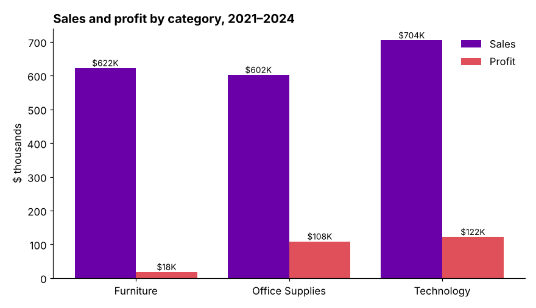

# SalesVision: Interactive Sales Analytics Dashboard

An **Excel** dashboard built on pivot tables, pivot charts and slicers. It turns 8,300+ order records into a view of revenue, profit, products, customers and regions, where every chart updates as you filter.

## Data

`Data` sheet: **8,314 orders** from January 2021 to August 2024, with order date, customer, US state, category, sub-category, product, sales, quantity and profit.

## What the dashboard shows

- **Profit by year**
- **Sales by category**
- **Sales by state**
- **Sales by month**, to spot seasonality
- **Top 5 customers by profit**
- **Count of customers by year**

**Slicers** for year, category and month filter every chart at once, so you can, for example, see only 2023 Technology sales.

## Key findings

- **Total sales of $1.93M and profit of $248K**, a 12.9% margin.
- **Furniture is the weak spot:** it brought in 32% of sales but only 7% of profit. Technology and office supplies earn far better margins.
- **Tables lost money:** −$12.3K over the period, the biggest loss of any sub-category, with bookcases also negative.
- **Two states drive a third of sales:** California and New York together account for 33%.
- **2023 was the strongest year** at $609K in sales and $82K in profit. The 2024 data covers January to August only.

## Repository

| File / sheet | What it is |
|---|---|
| `Sales dashboard.xlsx` | The workbook |
| ↳ `Data` | Raw order data |
| ↳ `pivot table` | Pivot tables behind each chart |
| ↳ `dashboard` | The interactive dashboard (charts and slicers) |
| `figures/` | Summary chart made from the `Data` sheet |

Open the workbook in Microsoft Excel (2016 or later) to use the slicers.

## Tools

Microsoft Excel: pivot tables, pivot charts, slicers, dashboard design

---

[Tisya Vaidya](https://tisyavaidya.com) · [LinkedIn](https://www.linkedin.com/in/tisya-vaidya/) · [GitHub](https://github.com/tisyavaidya)
